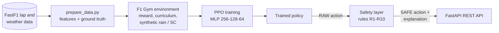

# F1 Race Strategy Agent – PPO with a Rule-Based Safety Layer

A reinforcement learning agent that makes Formula 1 race-strategy decisions – **pit stop, tyre compound and driving style** – on every lap. It is trained with **Proximal Policy Optimization (PPO)** on real lap data from the [FastF1](https://github.com/theOehrly/Fast-F1) library, and every decision is checked by an explicit **rule-based safety layer** that enforces race regulations and records which rule fired and why. The model is served through a **FastAPI** REST API.

The project combines a learned policy with verifiable rules: the policy proposes, the rules check. This pattern is common in safety-relevant automotive software, where a learned component must stay inside explicit constraints.

---

## At a glance



| Component | What it does |
|---|---|
| `prepare_data.py` | Downloads 2023 races (Silverstone, Monza, Spa) for four drivers (VER, HAM, LEC, PER), joins real weather data and builds observations and ground-truth actions |
| `f1_env.py` | Gym environment with a shaped reward, a three-level curriculum and block-wise synthetic rain/damp and Safety Car/VSC scenarios |
| `train.py` | PPO training (Stable-Baselines3), keeps the best checkpoint by reward per step |
| `safety_layer.py` | Ten named rules (wet tyres in rain, no aggressive style under Safety Car, two mandatory dry compounds, …) that override unsafe actions and explain every override |
| `api.py` | REST API: single prediction, batch prediction over a race, rule-based explanation |
| `predict_strategies.py` | Offline evaluation: RAW policy vs SAFE (policy + rules) against the real drivers' decisions |

### Action space

| Action | Values |
|---|---|
| Pit stop | 0 = stay out, 1 = pit |
| Compound | 0 SOFT, 1 MEDIUM, 2 HARD, 3 INTER, 4 WET |
| Driving style | 0 conservative, 1 neutral, 2 aggressive |

### Safety layer rules

| Rule | Condition | Effect |
|---|---|---|
| R1 | rain | compound must be WET |
| R2 | damp track | compound must be INTER |
| R3a | dry track | INTER/WET not allowed |
| R4 | critically low tyre life | pit is forced |
| R5 | dry track, tyres in very good condition | pointless pit is blocked |
| R6 | wet or damp track | no aggressive style |
| R7 | small gap to the car ahead | conservative style |
| R8 | large gap on a dry track | conservative style relaxed to neutral |
| R9 | Safety Car / VSC / red / yellow flag | no aggressive style (overtaking forbidden) |
| R10 | dry race, only one dry compound used near the end | pit and compound change are forced (FIA rule) |

---

## Results

Evaluation on all 674 laps of the dataset (12 driver–race combinations), SAFE = policy + safety layer:

| Decision | SAFE accuracy | Majority-class baseline |
|---|---|---|
| Compound | 69.6 % | 43.9 % |
| Driving style | 64.2 % | 42.1 % |
| Pit stop | 92.7 % (recall 88 %, precision 24 %) | 97.5 % (never pit) |

Pit stops happen on only ~2.5 % of laps, so accuracy is not a meaningful metric for them: a model that never pits reaches 97.5 %. The agent catches 15 of the 17 real pit stops (recall 88 %) at the cost of false alarms (it pits on ~9 % of laps). The asymmetric pit reward in `f1_env.py` is tuned for this trade-off.

> These numbers are measured on the same races the agent was trained on. An evaluation on held-out races is listed under [Known limitations](#known-limitations).

<!-- TODO: add training and evaluation plots, e.g. docs/reward_curve.png and docs/raw_vs_safe.png -->

---

## Prerequisites

- Python 3.10 or newer
- Internet access the first time `prepare_data.py` runs (FastF1 downloads and caches the data)

The trained models (`saved_models/`) and the prepared data (`data/`) are committed, so the API and the evaluation can run without retraining.

## Installation

```bash
git clone https://github.com/antonela-kovic/f1-race-strategy-ppo.git
cd f1-race-strategy-ppo
python -m venv .venv
source .venv/bin/activate        # Windows: .venv\Scripts\activate
pip install -r requirements.txt
```

`requirements.txt` includes `gym` and `shimmy`, because the environment uses the older `gym` API together with a newer `stable-baselines3`.

## Usage

### 1. Prepare data and train (optional)

```bash
python prepare_data.py   # downloads races and builds data/obs_array.npy, data/true_actions.npy
python train.py          # PPO training with curriculum, saves saved_models/*_best.zip
```

### 2. Evaluate

```bash
python predict_strategies.py
```

Prints RAW vs SAFE accuracy, the safety-layer override rate per field and the R10 check per race. The same evaluation is available interactively in `main.ipynb`.

### 3. Run the REST API

```bash
uvicorn api:app --reload
```

- API: http://127.0.0.1:8000
- Swagger UI: http://127.0.0.1:8000/docs

| Endpoint | Description |
|---|---|
| `GET /` | Health check |
| `POST /predict_strategy` | Strategy for a single lap state |
| `POST /predict_strategy_batch` | Strategy for a sequence of laps, treated as one race (R10 is checked automatically) |
| `POST /explain_strategy` | Rule-of-thumb explanation of a state, without the model |

The state is a list of 15 features in this order: `TyreLife, CompoundEncoded, LapNumber, TrackStatus, IsAccurate, Position, LapTime, Sector1Time, Sector2Time, FrontGap, RearGap, Stint, TrackTemperature, AirTemperature, Weather`.

Example request for `POST /predict_strategy`:

```json
{"state": [5, 2, 22, 2, 1, 8, 100.5, 35.0, 34.0, 0.5, 1.0, 2, 23.0, 18.0, 2]}
```

More examples:

```json
// Dry track, tyres in good condition
{"state": [20, 1, 12, 2, 1, 5, 91.2, 30.5, 30.1, 1.8, 2.2, 1, 30.0, 22.0, 1]}

// Rain
{"state": [7, 3, 18, 1, 1, 4, 105.0, 36.5, 35.2, 0.8, 1.5, 1, 19.0, 16.0, 3]}

// Hot track, MEDIUM compound
{"state": [15, 1, 9, 1, 1, 3, 95.0, 31.0, 30.0, 2.5, 3.0, 0, 36.0, 28.0, 1]}
```

The response contains the final (SAFE) action and an explanation with the RAW action, human-readable labels, violated rules and every override (shortened example):

```json
{
  "action": [0, 3, 0],
  "explanation": {
    "raw_action": [0, 1, 0],
    "safe_action": [0, 3, 0],
    "logic": {
      "overrides": [
        {"field": "compound", "from": 1, "to": 3, "rule": "R2_DAMP_REQUIRES_INTER", "why": "Damp: INTER is mandatory"}
      ]
    }
  }
}
```

For a batch request, send a list: `[{"state": [...]}, {"state": [...]}]`.

---

## Testing

Unit tests (pytest) cover the parts that do not depend on the FastF1 network or the trained model: the rules in `safety_layer.py`, the environment mechanics in `f1_env.py` (race segmentation, race-order shuffling, per-race bookkeeping, seeding) and the helpers in `utils.py`.

```bash
pytest -v
```

`prepare_data.py` is not tested directly because it calls the FastF1 API at import time; its pure helper functions (`classify_weather`, `worst_track_status`) live in `utils.py` so they can be tested in isolation.

---

## Project structure

```
├── api.py                  # FastAPI service
├── f1_env.py               # Gym environment: reward, curriculum, synthetic scenarios
├── train.py                # PPO training with evaluation and plots
├── safety_layer.py         # Rules R1-R10, overrides and explanations
├── predict_strategies.py   # Offline evaluation RAW vs SAFE, R10 check per race
├── prepare_data.py         # FastF1 data download and feature engineering
├── utils.py                # Features, observation scaling, pure helpers
├── model.py                # LSTM feature extractor (experimental, not used, see below)
├── main.py                 # Runs data preparation, training and the API in sequence
├── main.ipynb              # Interactive evaluation and API demo
├── test_*.py               # Unit tests
├── saved_models/           # Trained models (best and final)
├── data/                   # Prepared observations, ground truth, predictions
└── requirements.txt
```

---

## Known limitations

- **No held-out evaluation yet.** The results above are measured on the training races. The next step is to train on two tracks and evaluate on the third.
- **Synthetic gap features.** `FrontGap` and `RearGap` are generated synthetically, because FastF1 does not provide a reliable per-lap source for them.
- **Heuristic style labels.** The ground-truth driving style is a heuristic derived from `FrontGap`, `RearGap` and `TyreLife`; F1 data has no direct "style" label.
- **Pit frequency.** The agent pits more often than real drivers (~9 % of laps vs ~2.5 %), a consequence of the asymmetric reward that prevents the opposite failure (never pitting). The safety layer still enforces the strategy rules independently.
- **Not a physical race simulation.** The environment replays real laps with synthetic rain and Safety Car scenarios on top; `TyreLife` and other features do not change as a consequence of the agent's decisions.
- **No memory across laps.** `LSTMFeatureExtractor` in `model.py` is kept as a starting point for future work. Real memory over laps would require `RecurrentPPO` from `sb3-contrib` instead of standard PPO.

---

## Tech stack

Python · Stable-Baselines3 (PPO) · Gym · PyTorch · FastF1 · pandas · NumPy · scikit-learn · FastAPI · Pydantic · pytest · Matplotlib

## Author

Antonela Ković – [GitHub](https://github.com/antonela-kovic)
